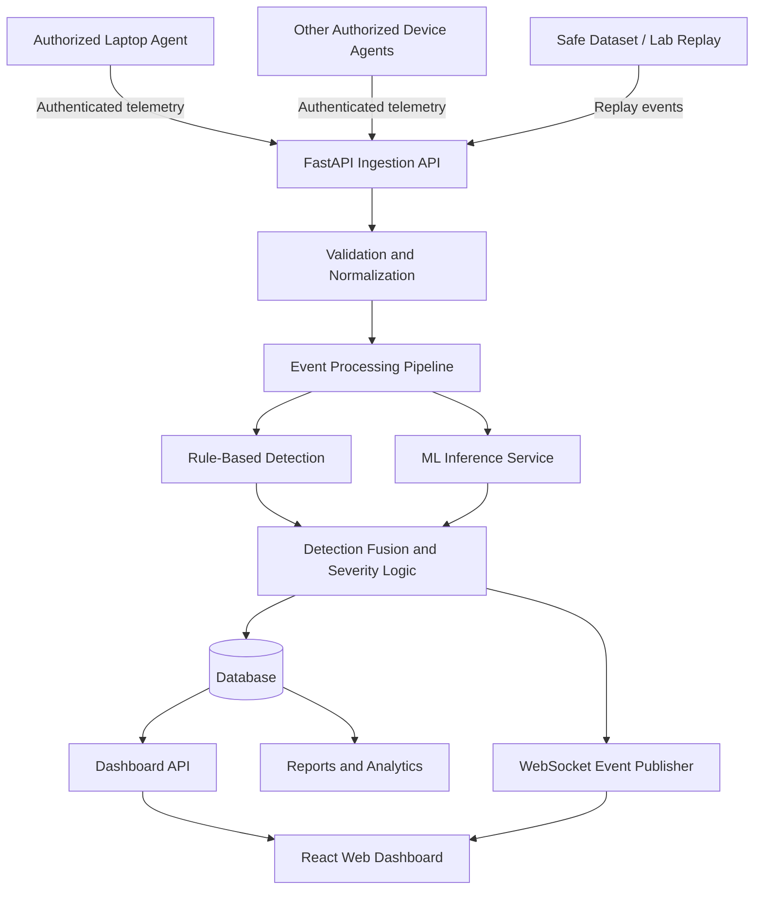
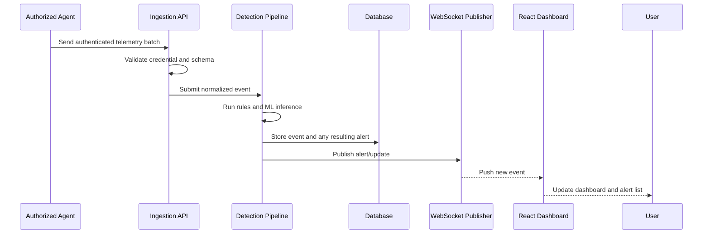
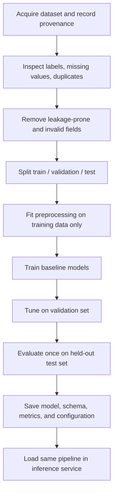

# AI-IDS: Intelligent Network Intrusion Detection and Real-Time Threat Monitoring System

> **Project type:** Final-year B.Tech Computer Science Engineering project  
> **Document type:** Complete project blueprint  
> **Scope:** One user's laptop and other explicitly authorized devices  
> **Proposed stack:** React, FastAPI, Python, scikit-learn, WebSockets, PostgreSQL/SQLite, and a lightweight endpoint agent

---

## 1. Project Overview

AI-IDS is a web-based intrusion detection and network threat-monitoring platform. It combines rule-based detection with machine-learning models to identify suspicious network behavior, present evidence-backed alerts, and help an authorized user investigate incidents.

The platform consists of a web dashboard, a backend API, a detection pipeline, a database, and a lightweight monitoring agent installed on devices the user owns or is authorized to monitor. The agent collects limited network-flow metadata or other explicitly configured telemetry and sends it to the backend. The backend analyzes events, stores alerts, and streams updates to the dashboard.

**Important scope boundary:** A website running in a browser cannot independently inspect all traffic on a laptop. Monitoring the laptop requires a local agent, operating-system permissions, and sometimes administrator privileges. Monitoring additional devices requires installing/configuring an agent or using an authorized network sensor. The project must not attempt to monitor devices without permission.

### 1.1 Proposed title

**AI-IDS: Intelligent Network Intrusion Detection and Real-Time Threat Monitoring System**

Alternative academic title: **A Hybrid Rule-Based and Machine-Learning Framework for Real-Time Network Intrusion Detection**

### 1.2 Abstract

Modern users and small organizations rely on connected devices that can be exposed to port scanning, brute-force attempts, denial-of-service activity, suspicious DNS behavior, and other network threats. Conventional monitoring tools may require specialist knowledge to interpret, while a machine-learning model alone can produce false positives or fail to explain its predictions.

This project proposes AI-IDS, a web-based intrusion detection and monitoring system combining rule-based indicators and machine-learning classification. A lightweight agent on authorized devices collects selected network-flow metadata. A backend validates and normalizes telemetry, applies detection rules and trained models, stores events and incidents, and pushes updates to a responsive dashboard. Users can inspect alert severity, timestamps, affected devices, evidence, model confidence where meaningful, and recommended investigation steps. Historical data can be filtered and exported for reporting.

The project will be evaluated using a labelled public benchmark dataset and, where feasible, controlled traffic captured in an isolated lab. Performance measures will include precision, recall, F1-score, false-positive rate, inference latency, and throughput. The system is intended as a defensive decision-support tool; detections are indicators requiring context, not proof that an attack has occurred. Automated blocking is outside the initial scope.

### 1.3 Keywords

Intrusion Detection System, Cybersecurity, Network Traffic Analysis, Machine Learning, Anomaly Detection, FastAPI, React, WebSockets, Security Monitoring, Threat Detection.

---

## 2. Problem Statement

Users may have difficulty understanding whether unusual network activity on their laptop or other authorized devices is benign or potentially malicious. Raw packet data and command-line monitoring tools can be difficult to interpret, while simplistic alerting systems may generate excessive false positives. A useful educational solution should collect appropriate telemetry, analyze it consistently, explain why an event was flagged, and provide a convenient way to investigate historical activity.

AI-IDS addresses this problem by building a modular defensive monitoring platform with a real-time dashboard, rule-based detection, machine-learning-assisted classification, device management, incident history, and measurable evaluation.

## 3. Motivation and Need

- Provide a single interface for monitoring multiple authorized devices.
- Make network security concepts easier to understand through visualizations.
- Combine transparent rules with statistical/ML methods rather than relying on one technique.
- Keep an auditable history of events and analyst decisions.
- Evaluate the detector using metrics that reveal false alarms and missed attacks.
- Demonstrate a practical full-stack engineering system with networking, APIs, databases, ML, testing, and deployment.

## 4. Objectives

### 4.1 Primary objectives

1. Build a secure web application with user authentication and a dashboard.
2. Collect approved network-flow metadata from a local laptop agent and other enrolled devices.
3. Display monitoring status, traffic summaries, devices, and security events in near-real time.
4. Implement transparent detection rules for selected suspicious patterns.
5. Train and evaluate at least one supervised ML model using labelled flow data.
6. Optionally add anomaly detection for traffic patterns that differ from a learned baseline.
7. Store alerts and investigation notes in a database.
8. Allow users to search, filter, acknowledge, resolve, and export incidents.
9. Evaluate detection quality, latency, throughput, and system reliability.
10. Document privacy, authorization, limitations, setup, and reproducibility.

### 4.2 Measurable success criteria

The final report should define target values after an initial baseline run. Suggested acceptance criteria are:

- The dashboard shows agent status and newly received events without requiring a page refresh.
- An authorized test agent can register, authenticate, send telemetry, and be revoked.
- The system records timestamps, device identifiers, detection reasons, and model/rule versions for alerts.
- A reproducible evaluation script reports precision, recall, F1-score, confusion matrix, and false-positive rate on a held-out test set.
- A documented test scenario produces an alert and can be traced through the backend to the dashboard.
- Authentication, authorization, input validation, and audit-log tests pass.
- The application handles agent disconnection and backend errors without silently losing the monitoring status.

These are project acceptance goals, not claims of achieved performance. Populate the final report with measured results from the implementation.

---

## 5. Scope

### 5.1 In scope

- Monitoring a user's own laptop and explicitly authorized devices.
- Device enrollment, authentication, revocation, and health status.
- Collection of limited network-flow metadata or authorized telemetry.
- Rule-based and ML-assisted detection.
- Near-real-time dashboard updates.
- Alert severity, evidence, status, and investigation notes.
- Historical search, charts, and CSV export.
- Dataset-based offline training and evaluation.
- Safe replay of labelled flows or approved lab captures for demonstrations.
- Role-based access and audit logs.
- Local development and optional containerized deployment.

### 5.2 Out of scope for the initial release

- Monitoring devices without consent or authorization.
- Secretly collecting browsing content, passwords, message content, or unrelated personal files.
- Decrypting TLS traffic or bypassing device protections.
- Guaranteed detection of every attack or attribution of an attack to a specific person.
- Automatically blocking network traffic, killing processes, or changing firewall rules.
- Public internet-wide scanning or offensive exploitation.
- Claims that a model is production-grade without independent validation.

### 5.3 Assumptions and constraints

- The developer has permission to monitor each enrolled device and network.
- Packet capture, when used, is restricted to a controlled environment and minimum required fields.
- Operating-system permissions and network interfaces differ by platform.
- Public datasets may not represent real-world traffic and may contain class imbalance or dataset-specific artifacts.
- A laptop may have no suspicious traffic during a demonstration; replay mode is provided for reliable evaluation.
- The project is a defensive prototype and is not a replacement for a professionally managed security platform.

---

## 6. Users and Roles

| Role | Capabilities |
|---|---|
| Administrator | Manage users, enroll/revoke devices, configure retention, view audit events, manage system settings |
| Analyst/Owner | View authorized devices, investigate alerts, add notes, acknowledge/resolve incidents, export reports |
| Read-only Viewer (optional) | View permitted dashboards and reports without changing records |

Use least privilege. A user should only see devices and incidents assigned to their account or organization.

## 7. Functional Requirements

| ID | Requirement | Priority |
|---|---|---|
| FR-01 | Register and authenticate users securely | Must |
| FR-02 | Enroll an authorized monitoring agent | Must |
| FR-03 | Revoke an agent credential | Must |
| FR-04 | Display online/offline status and last-seen time | Must |
| FR-05 | Ingest validated telemetry through an authenticated API | Must |
| FR-06 | Normalize flow fields and reject malformed input | Must |
| FR-07 | Run configurable rule-based checks | Must |
| FR-08 | Run a versioned ML model on supported features | Must |
| FR-09 | Store events, alerts, and incident status | Must |
| FR-10 | Push dashboard updates over WebSockets or an equivalent channel | Must |
| FR-11 | Search and filter incidents by time, device, category, and severity | Must |
| FR-12 | Show the reason/evidence behind a detection | Must |
| FR-13 | Export filtered records to CSV | Should |
| FR-14 | Show model evaluation metrics and model version | Should |
| FR-15 | Record user actions in audit logs | Must |
| FR-16 | Support safe dataset/flow replay for demonstrations | Should |
| FR-17 | Provide PDF reports | Could |
| FR-18 | Support multi-tenant organization management | Could |

## 8. Non-Functional Requirements

- **Security:** Enforce authentication, per-device credentials, authorization, secure transport in deployment, and safe secret storage.
- **Privacy:** Minimize collected fields, explain monitoring to device owners, and define data-retention rules.
- **Reliability:** Report agent/backend connectivity and ingestion failures explicitly.
- **Performance:** Measure event-ingestion latency, detection latency, and dashboard update latency under defined test loads.
- **Usability:** Provide clear severity labels, readable charts, empty states, and accessible contrast.
- **Maintainability:** Separate the agent, API, detection engine, model pipeline, persistence layer, and UI.
- **Reproducibility:** Pin dependencies, version datasets and models, document preprocessing, and store experiment settings.
- **Portability:** Support local development on a documented operating system; containerize services where practical.
- **Auditability:** Record significant administrative and incident-management actions without logging secrets.

---

## 9. System Architecture

### 9.1 High-level architecture



### 9.2 Component responsibilities

**Monitoring agent**
- Runs only on a device whose owner/administrator has authorized monitoring.
- Collects configured metadata such as protocol, timestamps, flow duration, packet/byte counts, and connection endpoints where appropriate.
- Uses batching and rate limits to reduce overhead.
- Authenticates with a device-specific credential.
- Reports health, version, interface, and last successful send time.
- Avoids collecting payload contents by default.

**Ingestion API**
- Authenticates the agent and checks whether it is enrolled and active.
- Validates schemas, types, timestamps, and allowed field sizes.
- Applies rate limits and rejects oversized or malformed batches.
- Adds server-side receipt timestamps and correlation identifiers.
- Prevents a device from submitting events for another device.

**Normalization and feature extraction**
- Converts incoming records to a canonical schema.
- Handles missing values and units consistently.
- Creates model features using the same preprocessing pipeline used during training.
- Does not infer missing information as if it were observed.

**Rule engine**
- Applies interpretable checks, for example high connection attempts across many ports in a short window.
- Uses configurable thresholds and per-device baselines where appropriate.
- Records the matched rule and the evidence that triggered it.

**ML inference**
- Loads a versioned, validated preprocessing/model pipeline.
- Produces a class prediction and, where supported, calibrated probability or confidence estimate.
- Rejects incompatible feature schemas rather than guessing.
- Records model version and the input feature schema version.

**Detection fusion**
- Combines rule findings and model output using documented logic.
- Avoids treating a model probability as a definitive measure of real-world risk.
- Produces an alert category, severity, evidence, and recommended next step.
- Deduplicates repeated alerts using a documented key and time window.

**Database and reports**
- Stores devices, telemetry summaries, alerts, users, audit events, and model metadata.
- Applies retention and access rules.
- Supports indexed filtering and report generation.

**Web dashboard**
- Displays current system health, traffic trends, devices, alerts, model metrics, and history.
- Receives updates through WebSockets.
- Provides a polling or refresh fallback if a real-time connection fails.

### 9.3 Deployment modes

1. **Local prototype:** React and FastAPI run locally, with SQLite for initial development.
2. **Demonstration deployment:** Containerized services and PostgreSQL; agent credentials limited to a test environment.
3. **Optional remote deployment:** Use HTTPS/WSS, strong secrets, firewall restrictions, authentication, monitoring, and explicit agent enrollment. Do not expose an unauthenticated ingestion endpoint to the public internet.

---

## 10. Data Flow



The ingestion response should indicate whether the batch was accepted, rejected, or partially accepted. Retries should use event identifiers or idempotency keys to avoid duplicate records.

---

## 11. Website Pages and User Experience

### 11.1 Login and registration
- Login, logout, and account creation if public registration is enabled.
- Passwords stored only as strong salted hashes using a reputable password-hashing library.
- Secure session management, login throttling, and clear errors that do not reveal whether a particular account exists.
- Optional administrator invitation instead of open registration.

### 11.2 Main dashboard
Display:
- Number of enrolled devices and devices currently reporting.
- Events/flows processed during a selected time window.
- Total alerts by severity.
- Recent alerts and their statuses.
- Traffic volume over time.
- Alert categories and model/rule source.
- Agent and backend health indicators.

Do not label a device “safe” merely because no alert has been detected. Prefer “No alerts observed during this period.”

### 11.3 Live monitoring
- Device selector and monitoring status.
- Inbound/outbound bytes or flows over time.
- Protocol distribution.
- Recent flow metadata with privacy-conscious defaults.
- Connection/agent health.
- Start/stop controls only for an authorized local agent or its approved service; the website must clearly show the effect of these controls.

### 11.4 Threat detection center
For each alert, show:
- Alert identifier and first/last observed timestamps.
- Device and relevant network endpoints, where collected.
- Category and severity.
- Detection source: rule, supervised model, anomaly model, or combined.
- Matched rule/evidence and important feature values.
- Model version and probability/confidence only when statistically meaningful.
- Suggested investigation steps.
- Status: new, acknowledged, investigating, resolved, or false positive.

### 11.5 Device management
- Device name, OS/platform, agent version, last-seen time, status, and enrollment date.
- Enroll a device using a short-lived enrollment flow or administrator-issued credential.
- Revoke device credentials.
- Display a clear warning when a device stops reporting.
- Never display full agent secrets after initial creation.

### 11.6 ML analytics
- Model name/version and training date.
- Dataset and feature schema used.
- Class-wise precision, recall, F1-score, confusion matrix, and false-positive rate.
- Inference latency and class distribution.
- Feature importance or explanation, with a note that explanations are approximate.
- Comparison across models on the same test split.

### 11.7 Incident history and reporting
- Filters for date range, device, severity, category, and status.
- Pagination and server-side filtering.
- Export only the records the current user is allowed to access.
- CSV export and optional PDF report.
- Investigation notes and audit trail.

### 11.8 Settings and audit log
- Alert thresholds and rule configuration.
- Data-retention duration.
- User/role management.
- Agent enrollment/revocation events.
- Audit entries for important actions and configuration changes.

---

## 12. Attack Categories and Detection Strategy

The system should focus on defensively identifying indicators rather than claiming certainty.

| Category | Possible indicators | Important caveat |
|---|---|---|
| Port scanning | Many destination ports or hosts contacted in a short period | Legitimate inventory tools can look similar |
| DoS/DDoS-like activity | Unusual packet/byte rates, connection bursts, repeated requests | High traffic alone does not prove an attack |
| Brute-force attempts | Repeated authentication failures in authorized application/system logs | Network flow metadata alone may not reveal login failures |
| Suspicious DNS patterns | High query rate, unusual query characteristics, repeated failures | Encrypted DNS and missing resolver logs limit visibility |
| Unusual outbound connections | New destinations, unusual ports, deviation from a baseline | New does not automatically mean malicious |
| Known labelled attack patterns | Model classification based on benchmark-derived flow features | Performance may not transfer to real traffic |
| General anomalies | Deviations from a learned baseline | Anomaly models often produce false positives |

### 12.1 Rule-based detection

Start with a small, explainable rule set:
- Excessive distinct destination ports from one source in a configurable time window.
- Abnormally high flow or packet rate relative to a defined threshold.
- Repeated connection failures where such telemetry is available.
- Repeated DNS failures or unusually high query rates when DNS metadata is available.
- Sudden deviation from a device's baseline traffic volume.

For every rule, document its required fields, threshold, time window, severity mapping, and known benign causes. Thresholds must be configurable and evaluated against representative normal traffic.

### 12.2 ML classification

A supervised classifier can label supported network-flow records as benign or one of the dataset's attack categories. The model's label set must match the training dataset; do not invent categories the model was not trained to identify.

Recommended starting models:
- **Random Forest:** Useful baseline for tabular flow features.
- **Decision Tree:** Easier to explain during a viva.
- **Logistic Regression:** A simple baseline.
- **Isolation Forest (optional):** Unsupervised anomaly-detection experiment; its anomaly score is not an attack probability.

Use a single reproducible preprocessing pipeline for training and inference. Avoid training on identifiers, timestamps, or dataset artifacts that leak the label. Split data carefully to reduce duplicate-flow and temporal leakage.

### 12.3 Detection fusion

A simple first version can retain rule and ML findings separately and use a transparent policy to prioritize alerts. If a combined score is introduced:
- Document every contributing signal and weight.
- Do not call the result a calibrated probability unless calibration has been tested.
- Let the user inspect the underlying evidence.
- Measure how fusion affects false positives and missed detections.
- Keep the original model output and rule result for auditability.

---

## 13. Dataset and Model Evaluation Plan

### 13.1 Candidate datasets

Evaluate the suitability, licensing, format, and known limitations of a public labelled dataset such as:
- **CICIDS2017** — widely used for flow-based intrusion-detection experiments.
- **CSE-CIC-IDS2018** — a larger benchmark with multiple attack scenarios.
- **UNSW-NB15** — a separate benchmark often used for network intrusion research.

Choose one dataset for the first implementation. Do not mix feature schemas from different datasets without an explicit mapping and evaluation plan. Read the dataset documentation and cite the exact version/source in the final report.

### 13.2 Training workflow



Recommended practices:
- Keep a fixed held-out test set that is not used for tuning.
- Use stratified splits when appropriate, but also consider time- or group-based splits to reduce leakage.
- Perform preprocessing fit only on training data.
- Report per-class metrics, not just overall accuracy.
- Handle class imbalance with appropriate weighting or sampling applied only to training data.
- Set random seeds and record library versions.
- Save the model together with its feature order, preprocessing steps, label mapping, and version.
- Do not load model files from untrusted sources; serialized Python objects can execute code during loading.

### 13.3 Metrics

| Metric | Why it matters |
|---|---|
| Precision | Of events flagged as a class, how many were correct? |
| Recall / Detection rate | Of true events in a class, how many were detected? |
| F1-score | Harmonic mean of precision and recall |
| False-positive rate | How often benign traffic is incorrectly flagged |
| Confusion matrix | Shows which classes are confused |
| PR-AUC | Useful for imbalanced classification tasks |
| Inference latency | Time to classify an event or batch |
| Throughput | Events processed per second under a defined test |
| Resource usage | CPU and memory impact on the monitored system |

Define the false-positive-rate formula using a stated binary or one-vs-rest setup. For multiclass evaluation, explain how class-wise values are aggregated.

### 13.4 Results template

Fill this table only after running the experiment.

| Model | Precision (macro) | Recall (macro) | F1 (macro) | False-positive rate | Inference latency |
|---|---:|---:|---:|---:|---:|
| Logistic Regression | TBD | TBD | TBD | TBD | TBD |
| Decision Tree | TBD | TBD | TBD | TBD | TBD |
| Random Forest | TBD | TBD | TBD | TBD | TBD |
| Isolation Forest (anomaly experiment) | TBD | TBD | TBD | TBD | TBD |

**Do not present TBD values as results.** Report the dataset version, split method, hardware, software versions, feature list, and any sampling or class-weighting strategy alongside the final results.

---

## 14. Proposed Technology Stack

| Layer | Recommended technology | Purpose |
|---|---|---|
| Frontend | React + TypeScript | Interactive web interface |
| Styling | Tailwind CSS | Responsive dashboard layout |
| Charts | Recharts or Chart.js | Traffic, severity, and model metrics |
| Backend | Python + FastAPI | REST API and service logic |
| Real-time delivery | WebSockets | Push new events and status changes |
| Agent | Python, with a carefully scoped collection library | Authorized local telemetry collection |
| Packet/flow collection | Scapy for lab/prototype use, or a flow-oriented collector | Collect approved metadata; platform support must be tested |
| ML | pandas, NumPy, scikit-learn | Preprocessing, training, evaluation, inference |
| Database | SQLite for prototype; PostgreSQL for multi-user deployment | Persistence |
| Migrations | Alembic (if using SQLAlchemy) | Versioned schema changes |
| Authentication | Secure server-side sessions or short-lived access tokens | User and agent authentication |
| Testing | pytest, HTTPX/TestClient, frontend test tooling | Unit, API, and integration tests |
| Packaging | Docker Compose (optional) | Reproducible local services |
| Version control | Git and GitHub | Source control and collaboration |

Keep versions pinned in dependency files. Confirm operating-system support and packet-capture permissions before selecting the final agent library.

---

## 15. Proposed Database Design

A normalized relational schema is recommended.

### 15.1 Core entities

**users**
- `id` — primary key
- `email` — unique login identifier
- `password_hash`
- `role`
- `created_at`
- `is_active`

**devices**
- `id` — primary key
- `owner_user_id` — foreign key to users
- `display_name`
- `platform`
- `agent_version`
- `credential_hash` or a reference to securely managed credentials
- `enrolled_at`
- `last_seen_at`
- `status`
- `revoked_at`

**network_events**
- `id` — event identifier
- `device_id` — foreign key
- `event_time`
- `received_at`
- `protocol`
- `source_ip` and `destination_ip` where needed
- `source_port` and `destination_port` where needed
- `flow_duration`
- `packets_in` / `packets_out`
- `bytes_in` / `bytes_out`
- `feature_schema_version`
- `ingestion_id` or idempotency key

Only store fields needed for the project's detection objectives. IP addresses and traffic metadata can be sensitive; access and retention must be controlled.

**alerts**
- `id`
- `device_id`
- `event_id` or event-window reference
- `category`
- `severity`
- `status`
- `detection_source`
- `rule_id` if applicable
- `model_version` if applicable
- `score` or probability only when its meaning is defined
- `evidence_json`
- `first_seen_at`
- `last_seen_at`
- `created_at`

**incident_notes**
- `id`
- `alert_id`
- `author_user_id`
- `note`
- `created_at`

**audit_logs**
- `id`
- `actor_user_id` (nullable for service actions)
- `action`
- `target_type`
- `target_id`
- `created_at`
- `metadata_json` with secrets and sensitive payloads excluded

**model_registry**
- `id`
- `model_name`
- `model_version`
- `artifact_reference`
- `feature_schema_version`
- `dataset_reference`
- `created_at`
- `metrics_json`

### 15.2 Indexes and retention

- Index alerts by `created_at`, `device_id`, `severity`, and `status`.
- Index events by `device_id` and `event_time`.
- Enforce foreign keys and suitable uniqueness constraints.
- Use pagination for large result sets.
- Define retention duration for raw events and longer retention only for necessary aggregate reports.
- Ensure exports apply the same authorization filters as the dashboard.
- Avoid storing passwords, API tokens, or full packet payloads in audit logs.

---

## 16. API Design

Illustrative REST API; final paths and response schemas should be implemented consistently and documented with FastAPI/OpenAPI.

| Method | Endpoint | Purpose |
|---|---|---|
| POST | `/api/v1/auth/register` | Create an account, if open registration is enabled |
| POST | `/api/v1/auth/login` | Authenticate a user |
| POST | `/api/v1/auth/logout` | End a session |
| GET | `/api/v1/dashboard/summary` | Return summary metrics for authorized scope |
| GET | `/api/v1/devices` | List permitted devices |
| POST | `/api/v1/devices/enroll` | Begin an authorized device enrollment flow |
| POST | `/api/v1/devices/{device_id}/revoke` | Revoke a device credential |
| GET | `/api/v1/devices/{device_id}` | View permitted device details |
| POST | `/api/v1/telemetry/batch` | Accept authenticated telemetry |
| GET | `/api/v1/alerts` | Search/filter authorized alerts |
| GET | `/api/v1/alerts/{alert_id}` | View alert evidence |
| PATCH | `/api/v1/alerts/{alert_id}` | Update alert status |
| POST | `/api/v1/alerts/{alert_id}/notes` | Add an investigation note |
| GET | `/api/v1/reports/alerts.csv` | Export authorized filtered records |
| GET | `/api/v1/models/metrics` | Show registered model evaluation metrics |
| GET | `/api/v1/audit-logs` | View audit events subject to role policy |
| WS | `/ws/events` | Stream authorized updates to the dashboard |

### API implementation notes

- Require user authentication for dashboard APIs and a separate device credential for telemetry ingestion.
- Check device ownership/organization scope on every resource access.
- Validate every request with typed schemas and reasonable limits.
- Apply request size and rate limits.
- Use pagination and stable sorting.
- Add event IDs/idempotency keys for retry-safe ingestion.
- Use HTTPS/WSS in deployed environments.
- Do not accept arbitrary model artifact paths or commands from API requests.
- Document error codes and avoid leaking stack traces to clients.

---

## 17. Proposed Project Folder Structure

```text
ai-ids/
├── README.md
├── PROJECT_BLUEPRINT.md
├── .gitignore
├── .env.example
├── docker-compose.yml
├── docs/
│   ├── architecture.md
│   ├── api-specification.md
│   ├── data-dictionary.md
│   ├── test-plan.md
│   └── report-outline.md
├── frontend/
│   ├── package.json
│   ├── src/
│   │   ├── app/
│   │   ├── components/
│   │   ├── pages/
│   │   ├── features/
│   │   │   ├── dashboard/
│   │   │   ├── devices/
│   │   │   ├── alerts/
│   │   │   └── analytics/
│   │   ├── services/
│   │   └── types/
│   └── tests/
├── backend/
│   ├── pyproject.toml
│   ├── app/
│   │   ├── main.py
│   │   ├── api/
│   │   ├── core/
│   │   ├── models/
│   │   ├── schemas/
│   │   ├── services/
│   │   │   ├── ingestion.py
│   │   │   ├── normalization.py
│   │   │   ├── rule_engine.py
│   │   │   ├── ml_inference.py
│   │   │   ├── alert_service.py
│   │   │   └── reporting.py
│   │   ├── db/
│   │   └── websocket/
│   └── tests/
├── agent/
│   ├── pyproject.toml
│   ├── agent/
│   │   ├── main.py
│   │   ├── collector.py
│   │   ├── flow_builder.py
│   │   ├── sender.py
│   │   └── health.py
│   └── tests/
├── ml/
│   ├── README.md
│   ├── data/                 # Keep datasets out of Git unless licensing permits
│   ├── notebooks/
│   ├── src/
│   │   ├── prepare_data.py
│   │   ├── train.py
│   │   ├── evaluate.py
│   │   └── export_model.py
│   ├── artifacts/            # Keep large/private artifacts out of Git as appropriate
│   └── reports/
└── scripts/
    ├── seed_demo_data.py
    └── replay_flows.py
```

Treat this as a target structure; create folders as needed instead of building every module at once.

---

## 18. Real-Time Dashboard Behavior

1. The agent batches telemetry and submits it over an authenticated connection.
2. The backend validates and normalizes the batch.
3. The detection pipeline processes events and writes durable records.
4. Only after persistence succeeds does the backend publish the resulting event/update.
5. The frontend updates counters, charts, and the alert list.
6. If WebSocket delivery fails, the client reconnects with backoff and fetches recent data to reconcile missed events.
7. The interface indicates stale data when the agent has stopped reporting.

Do not equate an open WebSocket with a healthy monitoring agent. Agent health should be based on authenticated heartbeats or recent telemetry.

---

## 19. Security and Privacy Considerations

### 19.1 Authorization and consent
- Monitor only devices and networks the operator owns or is explicitly authorized to administer.
- Explain what is collected, why, where it is sent, and how long it is retained.
- Provide an obvious way to stop monitoring and revoke an agent.
- Keep lab simulations isolated from unrelated networks.

### 19.2 Credentials
- Store user passwords as strong salted hashes using a vetted library.
- Store agent credentials securely; prefer hashed server-side credentials and rotation/revocation.
- Keep secrets in environment variables or a secret manager, never in source control.
- Do not hard-code production credentials in the agent or frontend.
- Use short-lived enrollment tokens and limit their scope.

### 19.3 Transport and application security
- Use HTTPS and WSS in deployment.
- Configure CORS narrowly.
- Protect cookie-based sessions against CSRF and set appropriate cookie flags.
- Apply rate limiting, request size limits, and strict schema validation.
- Use parameterized database operations/ORMs.
- Escape untrusted values rendered in the UI.
- Restrict WebSocket subscriptions to the authenticated user's authorized devices.
- Avoid exposing detailed exception traces to clients.

### 19.4 Data minimization
- Prefer flow metadata over full packet payloads.
- Do not collect passwords, message contents, or unrelated files.
- Restrict access to IP addresses and device metadata.
- Define retention and deletion policies.
- Avoid including sensitive payloads or credentials in logs, exports, screenshots, and reports.

### 19.5 Model and data security
- Treat uploaded telemetry as untrusted input.
- Validate feature ranges and schema versions.
- Never load arbitrary user-supplied serialized model artifacts.
- Version model artifacts and verify their provenance/integrity.
- Prevent dataset leakage between training and testing.
- Record the model version used for each prediction.
- Review data and thresholds for false positives before enabling operational use.

### 19.6 Safe response policy
The initial version should alert and recommend investigation, not automatically block connections. If response automation is later studied, implement it only in an isolated lab with explicit authorization, allowlists, human confirmation, rollback, and a full audit trail.

---

## 20. Testing Plan

### 20.1 Unit tests
- Feature extraction with valid, missing, malformed, and boundary-value data.
- Each rule's threshold and time-window logic.
- ML preprocessing and prediction schema compatibility.
- Alert severity mapping and deduplication.
- Authorization helper functions and retention logic.

### 20.2 API tests
- Successful and failed login.
- Unauthorized telemetry submissions.
- Revoked device credentials.
- Invalid schemas, oversized batches, and rate-limit behavior.
- User A cannot read or update User B's devices or alerts.
- Pagination, filters, exports, and error responses.
- WebSocket authentication and access control.

### 20.3 Integration tests
- Agent sends telemetry to API and the event appears in storage.
- A test event triggers a rule and is visible in the dashboard.
- ML inference runs with the registered feature schema.
- Acknowledging/resolving an alert is persisted and audited.
- WebSocket reconnect and dashboard reconciliation work.
- Agent disconnection changes status to stale/offline after a documented threshold.

### 20.4 ML tests
- Reproducible train/test split and saved random seeds.
- No preprocessing fit on the test set.
- Class-wise metrics and confusion matrix.
- Tests for class imbalance and unseen/missing values.
- Latency measurements on documented hardware.
- Comparison with a simple baseline.
- Review of false-positive examples.

### 20.5 System and usability tests
- Dashboard responsiveness on laptop and mobile-sized screens.
- Simulated agent disconnection.
- Database restart and recovery.
- Load test with a documented event rate and duration.
- Verify logs and error messages do not leak secrets.
- Confirm export respects access permissions.

### 20.6 Safe demonstration scenarios

Use generated flow records, labelled dataset rows, or captures from a lab you control. Do not generate disruptive traffic against public services or devices without permission.

Suggested scenarios:
1. Normal baseline traffic produces no high-severity alert.
2. Synthetic flow records with many destination ports trigger the port-scan rule.
3. Synthetic high-rate flow records trigger the configured traffic-rate rule.
4. A labelled benchmark row is classified by the trained model.
5. A revoked agent is rejected.
6. An offline agent is visibly marked stale/offline.
7. An analyst acknowledges an alert and the action appears in the audit log.

---

## 21. Performance Evaluation

Measure the following on documented hardware and software versions:

- **Ingestion latency:** time from API receipt to durable event storage.
- **Detection latency:** time from normalized event availability to completed detection.
- **Dashboard latency:** time from stored alert to browser display.
- **Throughput:** valid events processed per second at a specified payload size.
- **Resource usage:** agent/backend CPU and memory use during a defined test.
- **Reliability:** proportion of accepted events that become available in history without duplication or unexplained loss.
- **ML quality:** class-wise precision, recall, F1, false-positive rate, and confusion matrix.

Use repeated runs and report median and high-percentile latency where possible. Distinguish measurements on replayed benchmark data from live network measurements. Do not claim “real time” without defining and measuring the expected latency.

---

## 22. Development Roadmap

A suggested 10-week plan; adjust to the college calendar and team size.

| Week | Deliverable |
|---|---|
| 1 | Requirements, literature review, scope, dataset review, threat model |
| 2 | Architecture, database schema, API contract, wireframes |
| 3 | Backend skeleton, database, authentication and authorization |
| 4 | Agent enrollment, telemetry schema, safe collector/replay pipeline |
| 5 | Rule engine, alert persistence, device health |
| 6 | Dataset preparation, baseline models, evaluation scripts |
| 7 | ML inference integration, feature schema/versioning |
| 8 | React dashboard, charts, alert investigation, WebSockets |
| 9 | Integration/security tests, exports, performance measurements |
| 10 | Bug fixes, reproducibility, final report, demo, presentation and viva preparation |

### Milestones

- **M1:** Architecture and requirements approved.
- **M2:** Authenticated telemetry reaches the backend.
- **M3:** Rule-based alert appears end-to-end.
- **M4:** ML model is trained and evaluated reproducibly.
- **M5:** Real-time dashboard and history are functional.
- **M6:** Security checks and test report are complete.
- **M7:** Final demonstration and documentation are ready.

---

## 23. Risks and Mitigations

| Risk | Mitigation |
|---|---|
| False positives | Tune thresholds on representative benign data; show evidence; allow analyst feedback |
| Dataset leakage | Use careful splits, remove identifiers/artifacts, document methodology |
| OS-specific packet capture issues | Begin with dataset replay and a portable metadata collector; test target OS early |
| Agent disconnection | Heartbeats, last-seen status, retry/backoff, visible stale-data warnings |
| Sensitive telemetry exposure | Minimize fields, enforce access control, use encryption, set retention |
| Excessive project scope | Complete a working end-to-end MVP before advanced features |
| Model not useful on live traffic | Clearly separate benchmark results from live validation; treat as a research prototype |
| Credential compromise | Hash/rotate/revoke agent credentials; rate-limit and audit enrollment |
| High event volume | Batch ingestion, indexes, pagination, retention, and load tests |

---

## 24. Expected Outcomes

By the end of the project, the team should deliver:

1. A functional React dashboard.
2. A FastAPI backend with authenticated telemetry ingestion.
3. A monitoring agent for authorized devices, or a documented collector plus replay mode where platform constraints apply.
4. A rule engine with evidence-bearing alerts.
5. At least one trained and evaluated ML model, with optional model comparison/anomaly detection.
6. A persistent incident database and searchable history.
7. Real-time dashboard updates and device health indicators.
8. A documented API, architecture, data dictionary, and test plan.
9. Reproducible evaluation scripts and measured metrics.
10. A final report, presentation, and safe demonstration scenarios.

These are intended deliverables, not claims that the system already exists or has achieved particular detection performance.

## 25. Limitations

- Network-flow metadata does not expose every attack or application-level behavior.
- Some categories, such as brute-force attempts, require system or application authentication logs.
- Encryption limits visibility into packet contents; the project does not attempt to bypass encryption.
- Public datasets may be dated, synthetic, imbalanced, or unrepresentative.
- A model can learn dataset artifacts rather than general attack behavior.
- Alerts require human interpretation and may be wrong.
- The agent's visibility depends on operating system, permissions, network topology, and collection configuration.
- This educational prototype should not be marketed as a complete replacement for an enterprise IDS/SIEM.

## 26. Future Enhancements

- Multi-organization tenancy with stronger administrative separation.
- Additional network sensors and flow protocols.
- Drift detection and scheduled model evaluation.
- Analyst feedback workflow for reviewing false positives.
- Explainability using suitable feature attribution methods.
- Optional integration with established security event formats.
- More advanced alert correlation across devices.
- Carefully controlled containment in a lab after safety, authorization, and rollback design.
- Deployment hardening and independent security assessment.

## 27. Suggested Final-Year Report Structure

1. Introduction
2. Literature Review and Related Work
3. Problem Statement, Objectives, and Scope
4. Requirement Analysis and Feasibility Study
5. System Architecture and Design
6. Dataset Description and Methodology
7. Rule-Based and Machine-Learning Detection
8. Implementation Details
9. Testing and Results
10. Security, Privacy, and Ethical Considerations
11. Limitations and Future Scope
12. Conclusion
13. References
14. Appendices: API examples, test cases, setup instructions, and selected screenshots

Include actual screenshots, code excerpts, dataset citations, and measured results in the final report. Clearly distinguish planned features from implemented features.

## 28. Local Development and Run Plan

The exact commands depend on the final dependency versions and operating system. A typical development sequence is:

1. Install a supported Python version and Node.js.
2. Create a Python virtual environment for the backend and agent.
3. Install pinned dependencies from the project manifests.
4. Configure local environment variables using `.env.example`; do not commit `.env`.
5. Start the backend and verify its health endpoint.
6. Initialize the database and create a development account.
7. Start the React frontend.
8. Run the telemetry replay script to verify the full event path.
9. Enroll the local agent and grant only the permissions needed for the selected collection method.
10. Run tests before demonstrating the project.

The first end-to-end milestone should use synthetic or replayed records, so the dashboard and detection pipeline can be completed before OS-specific live collection is added.

---

## 29. Viva Preparation: Questions to Be Ready For

**Why combine rules and machine learning?**  
Rules are transparent and useful for known patterns; ML can identify combinations of features that are difficult to capture with a short list of rules. Both have limitations, so the system records the evidence and evaluates false positives.

**Why not use accuracy alone?**  
Class imbalance can make accuracy misleading. Precision, recall, F1-score, class-wise results, and false-positive rate better describe detection performance.

**How does the website monitor a laptop?**  
The browser does not have unrestricted packet-capture access. A separate authorized local agent collects the configured metadata and sends it to the backend.

**Can the system detect every attack?**  
No. Detection depends on available telemetry, trained labels, rules, and the environment. Alerts are evidence-based indicators, not guarantees.

**What is the role of WebSockets?**  
They allow the backend to push new alerts and status updates to connected dashboards without requiring a full page refresh.

**How do you avoid data leakage?**  
Use a held-out test set, fit preprocessing only on training data, inspect duplicate records and identifiers, and choose splits that reflect the evaluation objective.

**How do you protect privacy?**  
Collect the minimum necessary metadata, monitor only authorized devices, restrict access, secure credentials and transport, and enforce retention/deletion policies.

**How will you demonstrate the project if no attack occurs naturally?**  
Use safe replay of labelled records or synthetic test events in a controlled environment, and clearly label them as demonstration data.

---

## 30. Final Implementation Priorities

Build the project in this order:

1. **Working skeleton:** authentication, database, device list, dashboard layout.
2. **End-to-end event path:** safe replay sends a flow record, backend validates it, rule engine processes it, database stores it, dashboard displays it.
3. **ML pipeline:** reproducible training/evaluation and versioned inference.
4. **Live authorized agent:** device-specific credentials, metadata collection, heartbeats, retry logic.
5. **Investigation workflow:** alert filters, evidence, notes, statuses, and export.
6. **Hardening and evidence:** authorization tests, privacy review, latency/throughput measurements, screenshots, report, and demo.

A smaller, tested, explainable system is stronger than a large dashboard whose detections are not reproducible. Prioritize a working end-to-end flow, measured evaluation, and transparent limitations.

---

## References and Further Reading

Use the exact versions and documentation consulted in your implementation and cite them in the final academic report. Useful starting points include:

- scikit-learn documentation: https://scikit-learn.org/stable/
- FastAPI documentation: https://fastapi.tiangolo.com/
- React documentation: https://react.dev/
- OWASP Application Security Verification Standard: https://owasp.org/www-project-application-security-verification-standard/
- OWASP Cheat Sheet Series: https://cheatsheetseries.owasp.org/
- Wireshark documentation: https://www.wireshark.org/docs/
- CICIDS2017 dataset and related documentation: https://www.unb.ca/cic/datasets/ids-2017.html
- CSE-CIC-IDS2018 dataset and related documentation: https://www.unb.ca/cic/datasets/ids-2018.html
- UNSW-NB15 dataset information: https://research.unsw.edu.au/projects/unsw-nb15-dataset

**Academic integrity note:** Cite the papers, datasets, libraries, and documentation actually used. Do not report invented results or claim that planned features are already implemented.
